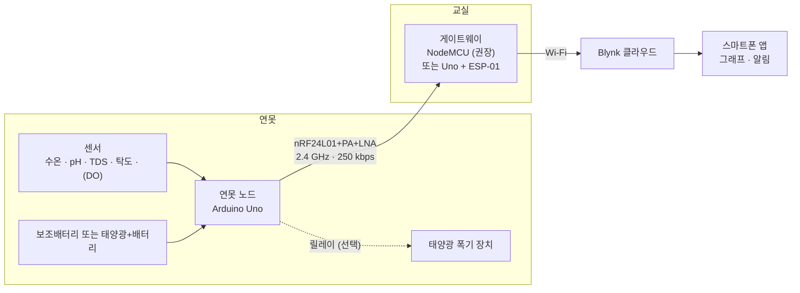
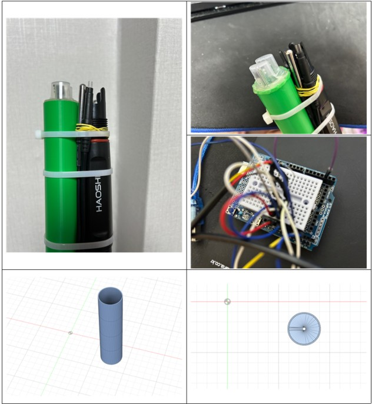
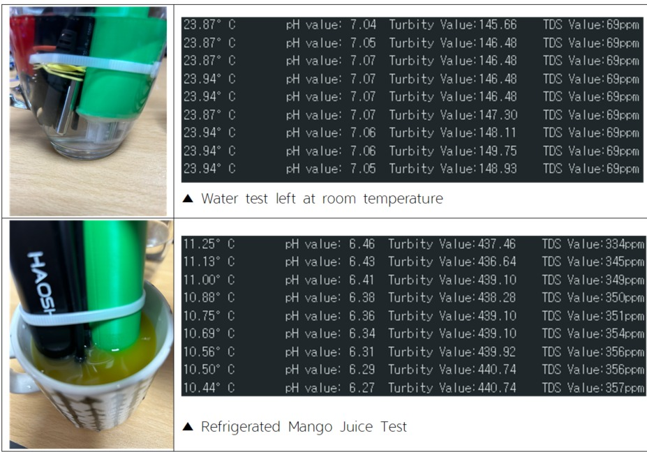
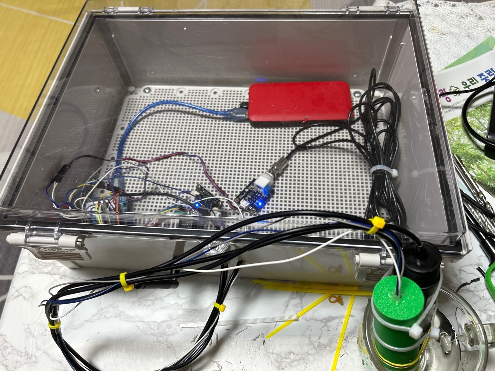
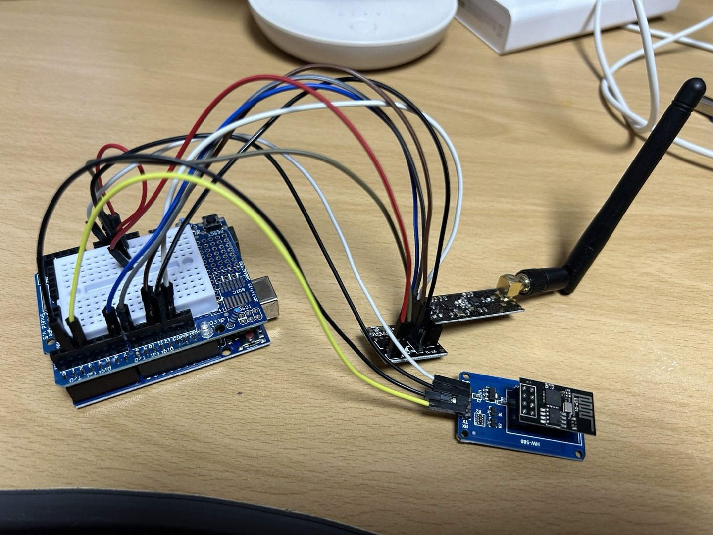
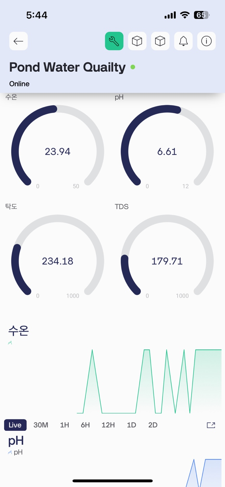
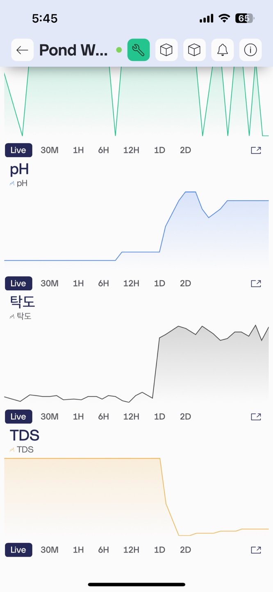
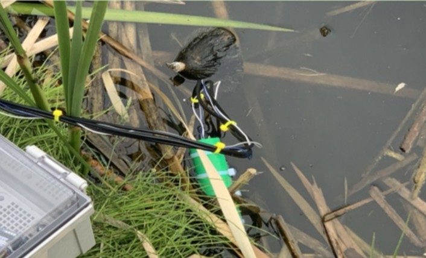

# Pond Water Quality IoT System

연못 수질 모니터링 & 태양광 폭기 정화 시스템 (Solar-Powered Aeration & Monitoring System for Purification)

[](https://github.com/SangHyeon-Shin/Pond-Water-Quality-IOT-System/actions/workflows/firmware.yml)

연못에 설치한 측정 노드가 수온·pH·TDS·탁도(선택: 용존산소)를 측정해 nRF24L01 무선으로 교실의 게이트웨이에 보냅니다.
게이트웨이는 Wi-Fi로 Blynk에 데이터를 올리고, 스마트폰에서 그래프와 알림으로 확인합니다.
정화는 태양광 폭기 장치가 담당합니다. 용존산소(DO) 센서를 달면 노드가 릴레이로 폭기 장치를 켜고 끕니다.

> **v2.0 (2026-10)**: 측정값을 왜곡하던 펌웨어 결함과 인증정보 노출을 수정하고, 교정·경보·폭기 제어를 추가했습니다.
> 2024 현장 시험 버전은 커밋 [`37dee70`](https://github.com/SangHyeon-Shin/Pond-Water-Quality-IOT-System/tree/37dee7029648153860d80945de4aa5533eba5bde)에서 그대로 볼 수 있습니다.
> 변경 내역은 [CHANGELOG.md](CHANGELOG.md)에 있습니다.

## 시스템 구성



| 항목 | 센서 | 노드 핀 | 교정 | Blynk |
|---|---|---|---|---|
| 수온 | 방수형 DS18B20 | D2 | 기준 온도계 (선택) | V0 |
| pH | DFRobot SEN0169-V2 (산업용 전극) | A2 | 2점 (pH 7.00 / 4.00) | V1 |
| 탁도 | DFRobot SEN0189 | A0 | 2점 (증류수 / 표준액) | V2 |
| TDS | DFRobot Gravity TDS | A1 | 표준액 1점 (k값) | V3 |
| 용존산소 (선택) | DFRobot SEN0237 | A3 | 공기 포화 1~2점 | V4 |

노드 공급전압(V6), 상태 비트(V7), 노드 연결 상태(V8), 패킷 손실률(V9), 폭기 상태(V5)도 함께 보냅니다.

## 저장소 구조

```
firmware/
  pond_node/            연못 노드 (Arduino Uno) — config.h에서 핀·주기·옵션 설정
  gateway_nodemcu/      게이트웨이, NodeMCU 1장 (권장)
  gateway_uno_esp01/    게이트웨이, 2024 하드웨어 (Uno + ESP-01)
  libraries/PondCore/   공통 코드: 패킷 정의, 변환식, 교정, 경보, 폭기 제어
  test/                 PondCore 단위 테스트 (PC에서 실행)
docs/                   하드웨어·교정·Blynk 설정 문서, 사진
hardware/               부품 목록 (bom.xlsx, bom.csv)
tools/                  폭기 효과 분석 스크립트
```

## 빠른 시작

1. **배선**: [docs/hardware.md](docs/hardware.md)
2. **라이브러리** (Arduino 라이브러리 매니저에서 같은 버전으로 설치)

   | 라이브러리 | 버전 | 사용처 |
   |---|---|---|
   | RF24 (TMRh20) | 1.6.2 | 전부 |
   | OneWire | 2.3.8 | 노드 |
   | DallasTemperature | 4.0.6 | 노드 |
   | Blynk | 1.4.0 | 게이트웨이 |
   | [BlynkESP8266](https://github.com/vshymanskyy/BlynkESP8266) (`ESP8266_Lib.h`) | 커밋 06e621a | Uno 게이트웨이만 (ZIP으로 설치) |
   | PondCore | 이 저장소 | 전부 |

   보드: Arduino AVR Boards 1.8.6 (Uno), ESP8266 core 3.1.2 (NodeMCU 1.0).
3. **Arduino IDE**: 환경설정 → *스케치북 위치*를 이 저장소의 `firmware` 폴더로 지정하면 PondCore와 세 스케치가 바로 보입니다.
   기존 스케치북을 유지하려면 `firmware/libraries/PondCore`를 스케치북의 `libraries` 폴더로 복사합니다.
   arduino-cli: `arduino-cli compile --fqbn arduino:avr:uno --libraries firmware/libraries firmware/pond_node`
4. **인증정보**: 게이트웨이 폴더의 `secrets.example.h`를 `secrets.h`로 복사하고 **새로 발급한** Blynk 토큰과 Wi-Fi 정보를 넣습니다([SECURITY.md](SECURITY.md)).
5. **업로드**: `pond_node` → 노드 Uno, `gateway_nodemcu`(또는 `gateway_uno_esp01`) → 게이트웨이.
6. **교정**: [docs/calibration.md](docs/calibration.md). 교정 전 값은 상태 비트에 "미교정"으로 표시되고 경보에 쓰이지 않습니다.
7. **Blynk**: 데이터스트림 V0~V9와 이벤트 3개 생성 → [docs/blynk-setup.md](docs/blynk-setup.md)

## 동작 방식

- **노드**: 60초마다 측정 → 송신 → 다음 주기까지 슬립(워치독). 각 아날로그 센서는 20~40개 샘플에서 상하위 10 %를 뺀 평균을 쓰고,
  DS18B20은 변환 완료를 기다린 뒤 CRC를 검사합니다. 범위를 벗어난 값은 NaN과 상태 비트로 보냅니다(가짜 숫자를 보내지 않음).
  TDS·DO는 측정 수온으로 온도를 보정합니다.
- **패킷 (29 B)**: 프로토콜 버전, 노드 ID, 순번, 상태 비트, 공급전압, 수온, pH, 탁도, TDS, DO, 폭기 상태.
  정의는 [`PondProtocol.h`](firmware/libraries/PondCore/src/PondProtocol.h) 한 곳에만 있습니다.
- **게이트웨이**: 수신 버퍼를 매번 모두 비우고 Blynk로 전달합니다. 순번으로 손실률을 계산하고, 노드가 5분간 조용하면
  `node_offline` 이벤트를 보내며, 교정된 값이 기준을 벗어나면 `water_quality_alert`를 보냅니다. 패킷마다 시리얼에 CSV 한 줄을 남깁니다.
- **유지보수 모드**: 노드 리셋 후 5초 안에 시리얼에서 Enter → 교정 명령 입력. 이 모드에서는 무선 송신과 슬립이 꺼집니다.

## 검증 현황

| 항목 | 방법 | 결과 |
|---|---|---|
| 공통 코드 (PondCore) | 단위 테스트 15종(검사 199개), g++ `-Werror` + AddressSanitizer/UBSan (CI) | 통과 |
| 노드 스케치 | avr-gcc 7.3 / AVR core 1.8.6 컴파일 | 플래시 59 %, RAM 31 % (옵션 전부 사용 시 플래시 66 %) |
| Uno 게이트웨이 | 같은 환경 컴파일 | 플래시 88 %, RAM 61 % |
| NodeMCU 게이트웨이 | ESP8266 core 3.1.2 컴파일 (CI) | 플래시 24 %, RAM 37 % |
| 노드 동작 | 스케치를 수정 없이 PC의 모의 하드웨어에서 실행: 정상 송신, 교정 명령, 재부팅, 센서·무선 장애, 폭기 제어 | 통과 |
| 실제 하드웨어 | — | **미실시**: 업로드 후 교정과 현장 재시험이 필요합니다 |

## 개발 기록 (2024)

| 프로토타입 | 알파 테스트 |
|---|---|
|  |  |
| 프로브 묶음과 3D 프린팅 홀더 | 수돗물·냉장 망고주스 비교. **교정 전 값**입니다(맑은 물 탁도 약 146 NTU 등) |

| 연못 노드 | 게이트웨이 (Uno + ESP-01) |
|---|---|
|  |  |

| Blynk 게이지 | Blynk 이력 그래프 | 현장 설치 |
|---|---|---|
|  |  |  |

2024 회로도와 구성도: [circuit-2024.png](docs/images/circuit-2024.png), [system-architecture-2024.png](docs/images/system-architecture-2024.png).
2024 구성도의 "ESP-12N"·"1000mAh"는 실제 구성(Uno + ESP-01, 10,000 mAh 보조배터리)과 달랐으며, 위 구성도가 현재 기준입니다.

## 알려진 한계

- v2.0 펌웨어는 실제 보드에서 아직 실행해 보지 않았습니다(컴파일과 PC 시뮬레이션으로만 확인).
- SEN0189 탁도 센서는 저탁도 분해능이 낮아 맑은 연못의 작은 변화는 구분하기 어렵습니다.
- Uno 보드 자체와 상시 켜진 탁도 센서 때문에 슬립을 해도 약 75~90 mA를 소비합니다(추정, [hardware.md](docs/hardware.md#5-전원)).
- 장기 데이터 보존 기간은 Blynk 요금제를 따릅니다. 분석용 원자료는 게이트웨이 시리얼 CSV로 남길 수 있습니다.

## 라이선스·출처

- 코드와 문서: [MIT License](LICENSE)
- 변환식: DFRobot 제품 자료(pH V1/V2 보드, GravityTDS, SEN0237 DO), 포화 용존산소 Benson & Krause (1984)
- 사용 라이브러리(RF24, OneWire, DallasTemperature, Blynk, BlynkESP8266)는 각 라이브러리의 라이선스를 따릅니다.
